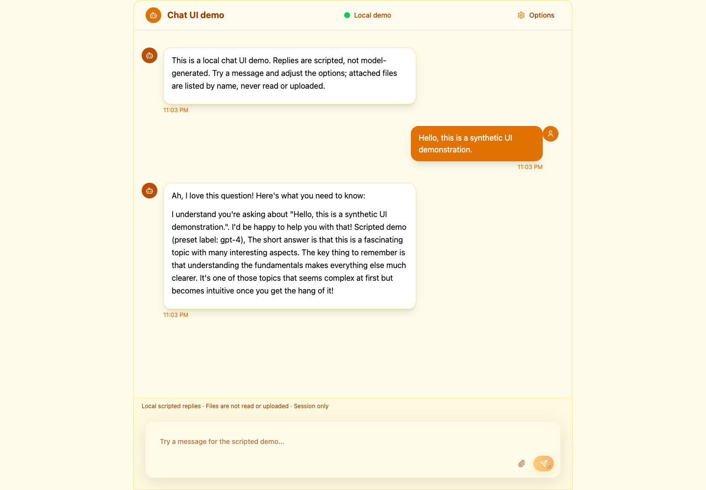
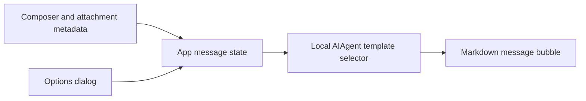

# Local chat UI prototype

A React/TypeScript interface for exploring chat interactions without a model service. Send messages, adjust response options, attach filenames and read scripted Markdown replies. The value here is the interface flow; the responses are templates, not AI inference or factual answers.



[390px mobile preview](docs/screenshots/mobile.png)

## Try it

Use Node 22.22+ and Yarn 1.22 with the committed lockfile:

```sh
yarn install --frozen-lockfile --ignore-scripts
yarn dev --host 127.0.0.1
```

No environment variables, account or API key are needed. For a production build and local preview:

```sh
yarn build
yarn preview --host 127.0.0.1
yarn lint
```

## Interactions worth exploring

- Enter sends; Shift+Enter adds a line break. IME composition does not accidentally submit.
- Up to five attachments, 10 MiB each, can be selected or dropped into the composer. The demo uses names/metadata only: it never reads file content or uploads files. Sending clears the pending attachments.
- Options change template selection, phrasing and optional outlines. Model names are preset labels only. Temperature is displayed but does not control a real sampler; length choices are template hints, not enforced sentence budgets.
- Replies render Markdown/GFM. Embedded images are replaced with a label to avoid automatic external image requests; links open only when clicked.
- Everything lives in React state for the current page session. Refresh clears the conversation and options.

## Small architecture, deliberate boundary



`src/App.tsx` owns messages and the simulated typing delay. `MessageComposer` handles draft input and file limits; `OptionsPanel` exposes settings through labeled controls. `src/lib/aiAgent.ts` selects canned response styles from keywords/options and a random fallback. Despite its class name, it is not an agent runtime: it has no tools, retrieval, memory service or provider integration.

The amber theme uses Tailwind, Radix-based dialog controls, Lucide icons and Framer Motion. The mobile layout uses dynamic viewport height to keep the composer usable with changing browser chrome; mobile keyboard behavior still needs device testing.

## Verification and remaining work

The TypeScript/Vite production build and ESLint pass. A Chrome/Playwright check exercised a scripted reply, filename-only attachment, response options, blocked Markdown image fetching and desktop/390px layouts. No external requests or page errors occurred in that synthetic run; both screenshots above come from it.

There is no committed unit-test runner yet; the browser verification was performed separately. The production bundle is about 562 kB before gzip and emits a chunk-size warning. Useful next steps are lazy-loading the options/Markdown paths, reproducible template tests, reduced-motion testing and message cancellation. A real model integration would require a server-side credential boundary, streaming/error handling and clear file-consent behavior rather than adding a key to this browser app.

This is a frontend prototype for portfolio balance, not evidence of model quality, document analysis or production agent engineering.
